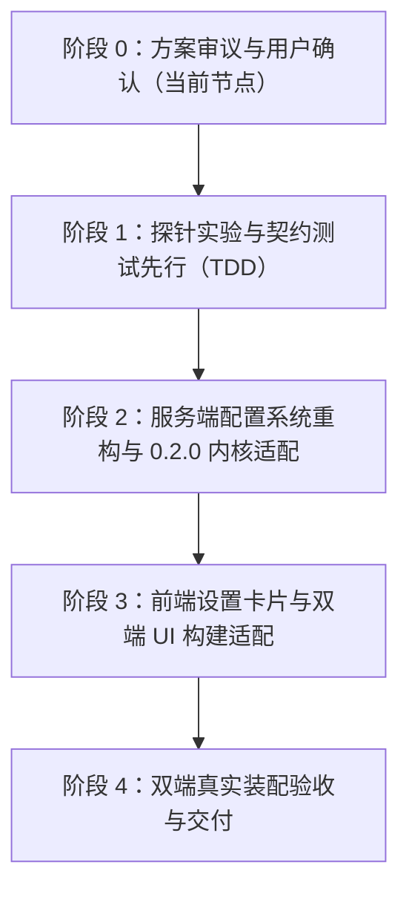

# DeepSeek Harness 0.2.0 更新深度调研与桌面端/Web 端适配规划

> **文档状态**：调研纪要与方案规划（待用户查验）  
> **调查日期**：2026-10-10  
> **基准版本**：DeepSeek Harness `0.2.0-rc.2`（上游仓库：`deepseek-ai/deepseek-harness`）  
> **对应规则**：严格遵循 `AGENTS.md` 决策与事实准确性原则（严禁凭空编造，证据分级标注）

---

## 1. DSH 0.2.0 更新全景剖析

自本项目初始基准版本 `0.1.5-rc.1` 以来，DeepSeek Harness 经历了 `0.1.6-alpha`、`0.1.7-rc.1/rc.2` 以及 `0.2.0-rc.1/rc.2`（alpha 分支当前已演进至 `0.2.1-alpha.2`）。0.2.0 是一个集成了**官方桌面端、即时设置系统重构、插件规范升级与内核强化**的里程碑版本。

### 1.1 官方桌面端（Desktop App）架构解密 【文档明写 + 源码核验】
- **双进程宿主模型**：
  - **壳层**：`apps/desktop`（Electron 44 容器，负责原生窗口、托盘、系统菜单、文件对话框、更新管理等）；
  - **核层**：`apps/desktop-host`（以 `ELECTRON_RUN_AS_NODE=1` 启动的独立 Node-mode 宿主进程，执行完整的 Cordis Profile Runner）。
- **内置免配置运行环境**：
  - 桌面端随包分发了专有 Node 运行时与完整 pnpm（位于 `primary-runtime/dependencies/pnpm`），普通用户**无需在操作系统预装 Node 或 pnpm**；
  - 菜单栏提供「管理 dsh 命令」入口，支持一键向系统注入独立 CLI 命令。
- **配置与数据隔离策略**：
  - 桌面端与系统 CLI 共享 `$DSH_HOME`（默认 `~/.dsh`）下的**会话、设置、凭据、工作区和存储**；
  - 但是，**可执行包、插件激活状态（Profile）与锁文件彼此物理隔离**。
- **Profile 与网络拓扑**：
  - 桌面端固定运行在专有 profile：`profile: 'desktop'`（而非 Web CLI 的 `web`）；
  - 桌面端 Webserver 默认绑定 `127.0.0.1`，端口使用操作系统随机分配的动态端口（`--port 0`），避免与独立 Web CLI（默认 3080）冲突；
  - Electron 渲染进程通过内部协议 `dsh-app://app/` 加载 WebUI 静态产物，并通过 Loopback 代理将 API 请求与 WebSocket 流转发至内部 `desktop-host`。

### 1.2 设置系统根本性重构（重大 Breaking Change） 【文档明写 + 源码核验】
这是对本插件影响最大的核心变革：
- **废弃独立的 `settings.yaml`**：
  - 0.1.5 时代的 `settings.yaml` 正式淘汰。升级至新版后，仅在首次启动时被单向导入当前 Profile 的 Cordis patch，原文件改名为 `settings.yaml.imported`。
  - 原有 `ctx.settings.installSection()` API 被彻底移除。
- **引入即时配置表单（Volatile Settings）**：
  - 插件配置全面统一融入 Cordis Profile 与 Patch 体系（`cordis.patch.yml`）；
  - 插件在 `Config` 中使用 Schemastery 的 `.volatile()` 声明支持热修改的字段，使用 `.role('secret')` 声明敏感凭据；
  - 插件直接在 `apply(ctx, config)` 中持有类型化的 `config` 引用，字段值为 `Volatile<T>`，调用 `.get()` 即可读取实时值；
  - 当用户在前端修改配置保存后，Cordis Loader 触发 `loader/volatile-update` 事件，插件无需重载实例即可完成对齐；
  - 自带定制卡片的插件需通过 `ctx.inject(['settings'], s => s.settings.configure({ auto: false }, ctx.fiber))` 告知系统跳过自动表单生成。

### 1.3 客户端模块系统与展示清单（Client Modules & Display Manifest） 【文档明写 + 源码核验】
- **Web 与 Desktop 前端同一套规范**：
  - 无论是浏览器 Web 还是 Electron 桌面端，前端均由 `@deepseek-ai/dsh-client-modules` 统一扫描并组装；
  - `package.json` 中的 `dsh.client.platform` 依然必须是 `"web"`（源码 `packages/client/modules/src/index.ts:840` 硬编码检查 `decl.platform === 'web'`，桌面端渲染层即 Web 消费方）；
  - 客户端产物依然采用 Lazy-CJS Factory 规范（`window.__ModuleLoader__.load({ id: "<pkg>/client", factory: ... })`）。
- **插件展示文本与图标规范收拢**：
  - 插件根目录的 `package.json` 包含 `name`、`description` 和 `icon`；
  - 多语言展示支持 locale 文件（`meta.title`、`meta.description`）。

### 1.4 Agent 内核与生命周期改进 【文档明写】
- **会话持久化 V4**：JSONL 日志引入规范 generation 概念，提交后不可变；
- **流式增量收拢**：实时增量统一来自 `agent/assistant-stream`（我们已完全对齐此项，第一期探针已证实）；
- **服务接口弃用**：废弃了 `session.snapshotEvents`、`session.eventAt` 等同步历史读取接口；
- **官方适配器变迁**：DeepSeek 适配器全面锁定 Messages API。

---

## 2. 桌面端 vs Web 端：桥接插件的深度适配分析

### 2.1 拓扑关系与网络模型差异
| 维度 | Web 部署模式 (`dsh web`) | 桌面端模式 (DSH Desktop App) | 桥接插件应对方案 |
|---|---|---|---|
| **进程形态** | 独立 Node.js / CLI 进程 | Electron 主进程 + `desktop-host` 子进程 | 插件始终运行在 Cordis 容器内，代码逻辑一致 |
| **Profile** | 通常为 `web` 或自定义 | 固定为 `desktop` | `cordis.patch.yml` 为通用层，不受 profile 名字限制 |
| **绑定端口** | 默认 `3080` (或手动配置) | `127.0.0.1:0` (系统随机动态端口) | **完全无影响**：本插件是出站反向连接 QQ 开放平台，不暴露本地 HTTP 端口 |
| **前端承载** | 系统外部浏览器 (Chrome/Edge等) | 内置 Chromium (Electron 44) | 前端均执行 `dsh.client` 的 Lazy-CJS 产物，DOM 与 React 18 环境一致 |
| **环境依赖** | 依赖宿主 Node / pnpm | 内置独立 Node / pnpm | 用户安装更便捷，npm 发布后桌面端插件市场直接可用 |

### 2.2 桌面端特有生命周期的适配要求
1. **退出检查（Quit Inspection）**：
   - 桌面端关闭主窗口或退出应用时，会触发 `quit-inspection`，探测是否有正在进行的任务。
   - 适配点：插件在 `dispose` 时必须干净清理 QQ WebSocket 连接、定时心跳及挂起的流式会话，避免悬挂句柄阻止桌面端退出。
2. **多实例与互斥**：
   - 用户可能同时安装了 Desktop 又在终端运行 `dsh web`。两者的 `$DSH_HOME` 共享，但 profile 独立。
   - 适配点：QQ 官方机器人同一 AppID 在一个时刻只能维持一个活动的 WebSocket Session。如果用户同时启动 Desktop 和 Web，后启动者会导致旧连接收到踢下线事件。插件需要完善日志提醒与平滑重连退避策略。

---

## 3. 本项目需改造适配的内容清单

根据对 DSH 0.2.0-rc.2 源码与架构的全面核对，梳理出以下必须改造与优化的任务项：

### 3.1 【重大改造】设置系统迁移（对齐 0.2.0 Volatile 规范）
- **当前现状**：
  - `src/index.ts:640` 依赖旧版 `settingsService.installSection()`；
  - 依赖 `settings/updated` 和 `settings/document-updated`；
  - 前端 `src/client/index.tsx` 通过旧版 `settingsScope.bind({ namespace })` 读写已废弃的 `settings.yaml`。
- **0.2.0 目标适配方案**：
  1. **配置 Schema 声明即时字段**：
     在 `src/config/schema.ts` 中，使用 Schemastery 将 `app_id`、`app_secret`、`token`、`admins` 等字段标记为 `.volatile()`，敏感凭据标记为 `.role('secret')`；
  2. **服务端配置消费与监听**：
     - `apply(ctx, config)` 接收带有 `Volatile<T>` 的强类型配置对象；
     - 监听 `ctx.on('loader/volatile-update', () => ...)`，当用户在 WebUI/桌面端设置页保存时，直接响应热更新，无需重载整个插件实例；
     - 在 `apply` 中注册 `ctx.inject(['settings'], s => s.settings.configure({ auto: false }, ctx.fiber))`，声明本插件使用自定义 UI 卡片；
     - 彻底删除 `settingsService.installSection` 与 `readSettings()` 的旧兼容分支。
  3. **前端设置卡片（`src/client/index.tsx`）对接 Profile Patch Mutate**：
     - 对齐官方推荐的 `form.state` 与 `form.mutate(operations, expectedRevision)` 接口；
     - 表单命名空间对齐为 profile entry id：`dsh-qqbot-bridge`。

### 3.2 【工程配置】依赖与构建配置对齐
- **`package.json`**：
  - 将 peerDependencies 与 devDependencies 中的 `@deepseek-ai/dsh-*` 从 `^0.1.5-rc.1` 提升至 `^0.2.0-rc.2`（或锁定 `0.2.0-rc.2`）；
  - Cordis 依赖升级至 `~4.0.4`；
  - 确认 `@deepseek-ai/schemastery` 升级至 `~3.18.4`；
  - 增加/更新 `package.json` 中的 `dsh` 元数据声明，确保 `icon` 字段指向合规的图标资源（<= 256 KiB）。
- **`src/boot.ts`（契约测试装配底座）**：
  - 移除对硬编码 `settings.yaml` 路径的依赖；
  - 更新装配时的 default overlays，移除旧版 settings 的 `path` 字段，使其与 0.2.0 的 `config-editor` + `settings` 体系兼容。

### 3.3 【双端体验】桌面端与 Web 端兼容性加固
- **运行环境自适应探测**：
  - 增加环境感知工具（感知当前运行在 CLI Web 还是 Desktop Host）；
  - 针对桌面端可能出现的无控制台交互特性，将 QQ 机器人的重要状态（连接成功、鉴权失败、收发消息概况）以更规范的 logger 输出，并考虑向 WebUI 托盘/卡片状态提供自省能力；
- **优雅退出响应**：
  - 确保 Cordis `dispose` 钩子能 100% 释放 WebSocket、清理定时器、终止未决的网络请求，确保桌面端退出时 `quit-inspection` 能够秒级顺利放行。

---

## 4. 详细实施规划与分阶段路线图

为确保开发过程严谨、稳健，严格遵循 `AGENTS.md` 的 TDD、复用优先以及事实准确性要求，制定以下四阶段路线图：

### 阶段 1：探针实验与契约测试先行（TDD）
1. **编写探针脚本 `scripts/probe-020-settings.ts`**：
   - 验证在 DSH 0.2.0-rc.2 环境下，`Volatile` 字段的定义方式、`loader/volatile-update` 的触发时序，以及 `ctx.settings.configure` 的行为；
   - 产出 `logs/probe/E13-volatile-settings.jsonl` 实测日志。
2. **编写升级后的契约测试用例**：
   - 编写针对 0.2.0 装配路径的契约测试（验证 `bootDshQqbotBridge` 成功挂载、服务注入正常、配置热更新正常）。
   - 按照 AGENTS.md §3.4，契约测试在未修改实现前保持红色。

### 阶段 2：服务端配置系统重构与 0.2.0 内核适配
1. 更新 `package.json` 依赖版本至 `0.2.0-rc.2`；
2. 改造 `src/config/schema.ts`，为配置引入 `.volatile()` 与 `.role('secret')`；
3. 重构 `src/index.ts` 中的设置接线逻辑，彻底剥离旧版 `settings.yaml` 机制，接入 `Volatile` 引用与 `loader/volatile-update` 监听；
4. 修复并更新 `src/boot.ts` 装配脚手架，让服务端相关契约测试自然转绿。

### 阶段 3：前端设置卡片与双端 UI 构建适配
1. 重构 `src/client/index.tsx` 中的桥接逻辑，适配 0.2.0 的 Profile Mutate 机制；
2. 执行 `pnpm run build:client` 重新打包 `dist/client.js`；
3. 验证卡片在桌面端与 Web 端加载时的属性注入与保存行为。

### 阶段 4：双端真实装配验收与交付
1. 运行完整测试套件 `pnpm test`（确保 build + vitest 全绿）；
2. 验证真机/实际启动链路（Web 端 `dsh web` 与 桌面端 profile 模拟）；
3. 编写交付总结报告归档到 `docs/`。

---

## 5. 待请示与确认事项（用户决策制）

1. **版本升级范围**：是否同意将项目的 DSH 依赖基线从 `0.1.5-rc.1` 全面提升至 `0.2.0-rc.2`？
2. **旧版配置迁移策略**：是否确认彻底放弃对 0.1.5 旧版 `settings.yaml` 的私有读写兼容，完全切换至 0.2.0 官方标准的 Profile Patch / Volatile 配置机制？（推荐：完全拥抱 0.2.0 标准规范，避免残留技术债）
3. **桌面端专属体验**：在 QQ 机器人连线状态提示方面，除了现有的 WebUI 设置卡片状态显示外，是否需要在设置卡片中增加一个可视化的「双端连接诊断面板」（显示当前运行平台 Web/Desktop、QQ 网关连线状态、活跃会话数）？
